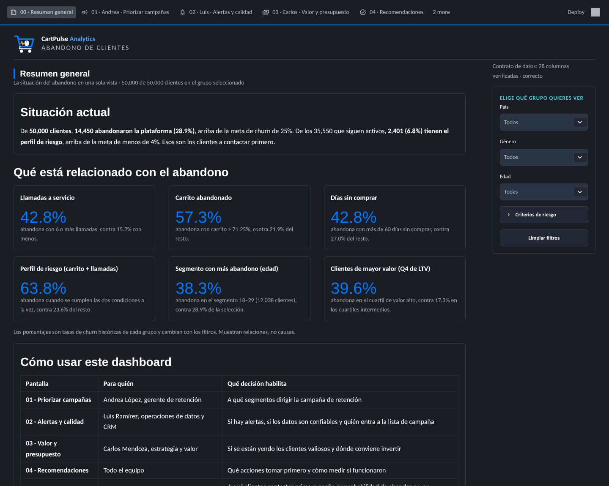
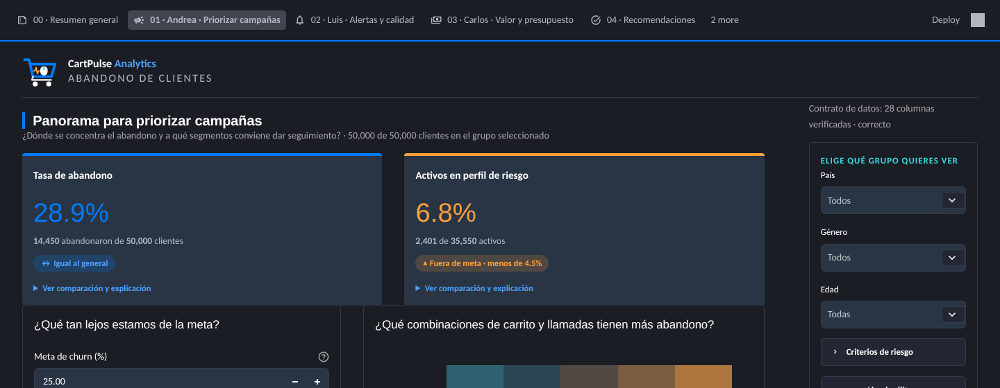
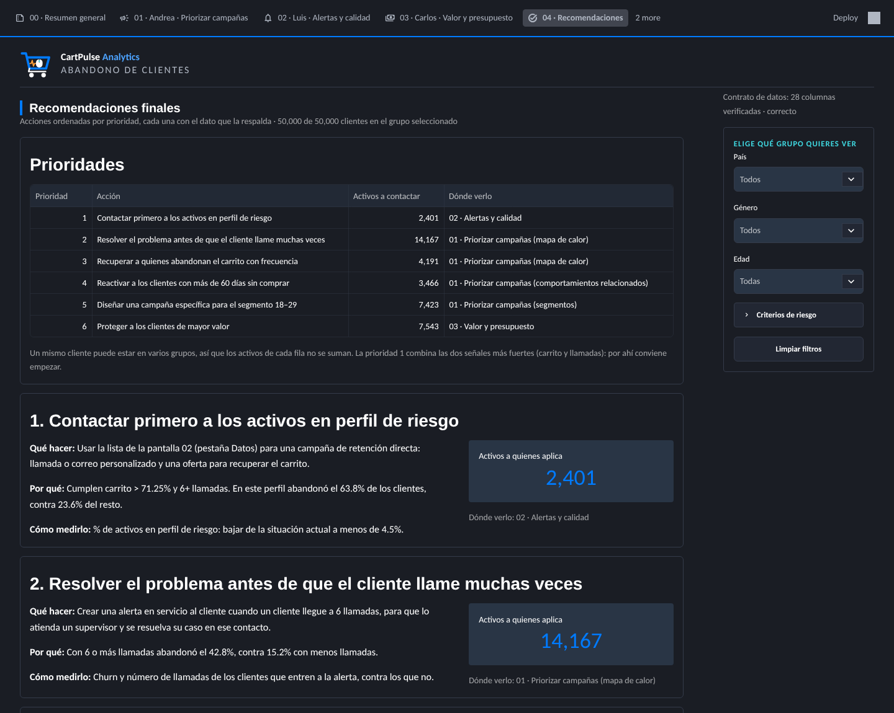
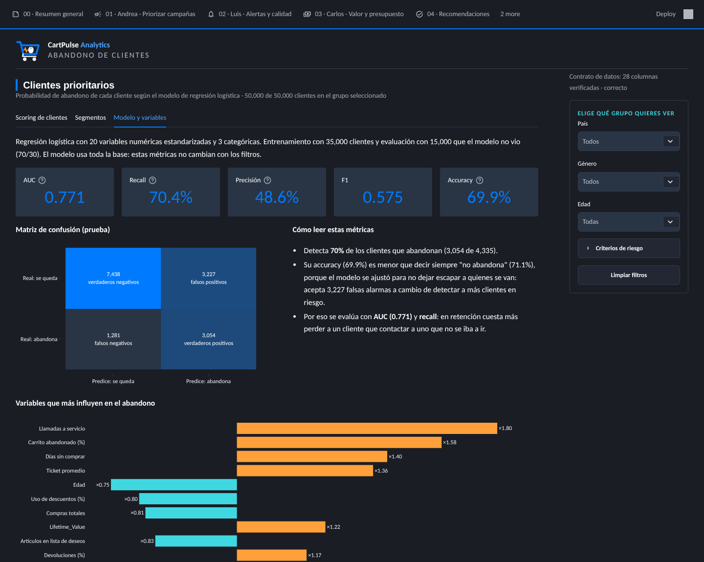
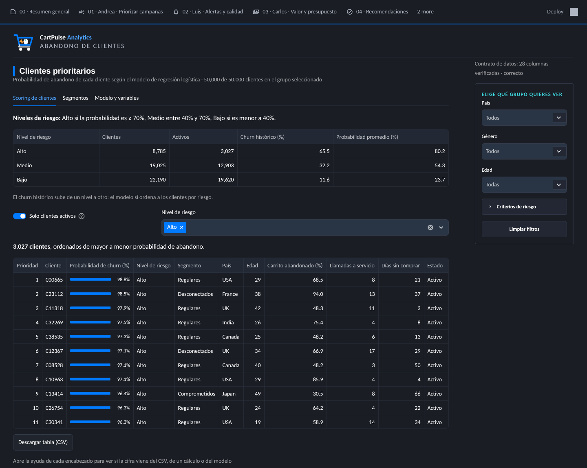
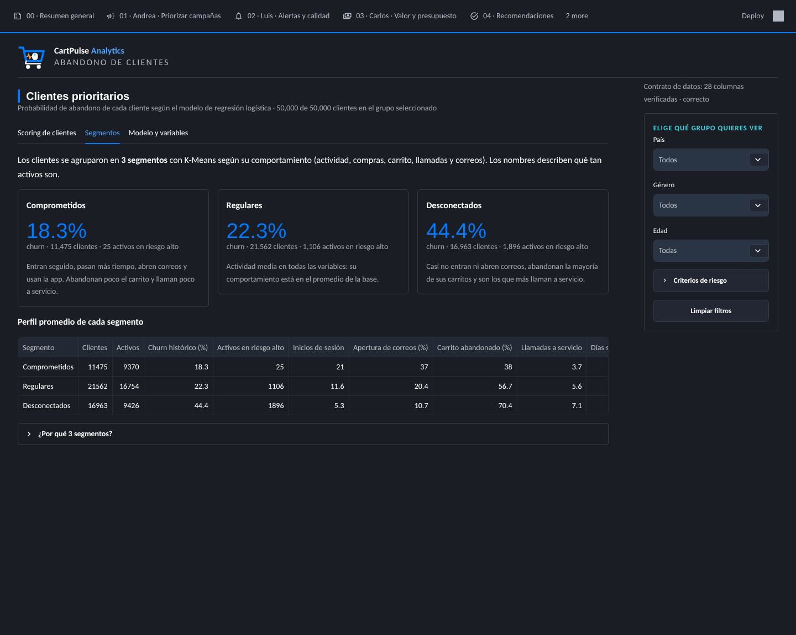
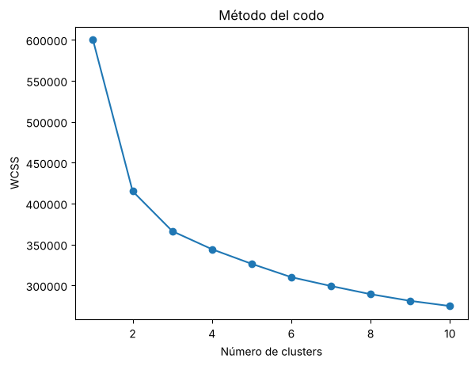
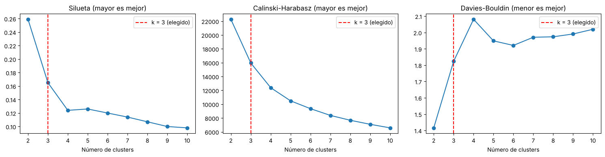

# Mi avance de la semana

Sara Elizabeth Rivero Hernández - A01666516
Equipo 5, E-commerce customer churn

Mis compromisos de esta semana en la hoja de la concentración eran:

- **Enrique:** regresión logística (semana 13) y perfil y nombre de cada cluster (semana 14).
- **Christelle:** scoring de toda la base: tabla de clientes ordenada por riesgo y descargable (semana 14).

Además atendí la retroalimentación que nos dio el profesor sobre el dashboard: quitar el total de clientes de los KPI, agregar un resumen general al inicio y una sección de recomendaciones finales.

Todo quedó en el dashboard de Streamlit: https://proyecto-churn-kble5abrozjksmebbubndb.streamlit.app

## 1. Resumen general (pantalla 00)

Es la primera pantalla que se abre. En una sola vista muestra la situación del abandono contra las metas (28.9% de churn contra la meta de 25%, y 2,401 activos en perfil de riesgo), seis hallazgos con la tasa de abandono de cada grupo (llamadas, carrito, días sin comprar, perfil de riesgo, segmento con más abandono y clientes de mayor valor) y una guía de qué decisión habilita cada pantalla. Todo se recalcula con los filtros.

Archivos: `paginas/resumen.py` (pantalla) y `src/resumen.py` (cálculos, solo pandas).

## 2. KPI sin el total de clientes

Quité la tarjeta de clientes de la pantalla de Andrea. Quedan dos indicadores: tasa de abandono y activos en perfil de riesgo, como pidió el profesor ("con uno o dos indicadores es suficiente").

Archivos: `paginas/andrea.py` y `src/seccion_kpis.py`.

## 3. Recomendaciones finales (pantalla 04)

Seis acciones ordenadas por prioridad. Cada una dice qué hacer, el dato que la respalda, a cuántos clientes activos aplica, cómo medir si funcionó y en qué pantalla se ve. También se recalculan con los filtros y con la regla de riesgo.

Archivos: `paginas/recomendaciones.py` y `src/resumen.py`.

## 4. Regresión logística (Enrique, semana 13)

Entrené un modelo de regresión logística para predecir el abandono con 20 variables numéricas estandarizadas y 3 categóricas (género, país y trimestre de alta). Dividí la base 70/30 de forma estratificada (35,000 clientes para entrenar y 15,000 para evaluar).

Resultados en los 15,000 clientes de prueba: AUC 0.771, recall 70.4%, precisión 48.6%, F1 0.575 y accuracy 69.9%.

Decidí balancear las clases (`class_weight="balanced"`): sin balancear, el modelo solo detectaba 39% de los clientes que se van. Con balanceo detecta 70%, a cambio de que la accuracy quede un poco abajo de la línea base (71.1%, que es decir siempre "no abandona"). En retención cuesta más perder a un cliente que contactar a uno que no se iba a ir, por eso evaluamos con AUC y recall.

Archivo: `src/modelo.py` (`entrenar_modelo`, `coeficientes`).

## 5. Scoring de toda la base (Christelle, semana 14)

En la pantalla **05 · Clientes prioritarios** cada cliente tiene su probabilidad de abandono y un nivel de riesgo: Alto (70% o más), Medio (40% a 70%) y Bajo (menos de 40%). La tabla está ordenada de mayor a menor probabilidad y se descarga en CSV. Hoy hay 3,027 clientes activos en riesgo alto.

El churn histórico baja de un nivel a otro (65.5% en Alto, 32.2% en Medio y 11.6% en Bajo), lo que confirma que el modelo sí ordena a los clientes por riesgo.

Archivos: `src/modelo.py` (`puntuar`, `tabla_scoring`, `resumen_niveles`) y `paginas/clientes.py`.

## 6. Perfil y nombre de cada cluster (Enrique, semana 14)

Agrupé a los clientes con K-Means usando 12 variables de comportamiento estandarizadas (sin edad, país ni género). Con el método del codo elegimos **3 clusters**: el WCSS deja de bajar de forma importante después de 3, y con 4 grupos dos de ellos quedaban con un churn casi igual (18.2% y 18.4%).

| Cluster | Clientes | Churn | Perfil |
|---|---|---|---|
| Comprometidos | 11,475 | 18.3% | Entran seguido, abren correos, usan la app y abandonan poco el carrito |
| Regulares | 21,562 | 22.3% | Actividad media, en el promedio de la base |
| Desconectados | 16,963 | 44.4% | Casi no entran, abandonan 70% de sus carritos y son los que más llaman a servicio |

Los nombres se asignan por el promedio de inicios de sesión (de más a menos activo), así no cambian si el modelo se vuelve a entrenar.

La validación estadística está en el Colab `notebooks/Equipo5_KMeans_Clustering.ipynb`, con la misma estructura del notebook de clase: método del codo, silueta, Calinski-Harabasz y Davies-Bouldin, estabilidad con otras semillas (ARI de 0.98 a 0.996), Kruskal-Wallis por variable, prueba ji cuadrada del churn por cluster (p < 0.001, V de Cramér = 0.248) y comparación con cluster jerárquico.

Archivos: `src/modelo.py` (`entrenar_segmentos`, `perfil_segmentos`) y `notebooks/Equipo5_KMeans_Clustering.ipynb`.

## Mis commits

- Resumen general, recomendaciones y KPI sin total de clientes (10 de nov): https://github.com/a01666361-beep/proyecto-churn/commit/7f996f6
- Modelo de regresión logística, scoring y pantalla 05 (11 de nov): https://github.com/a01666361-beep/proyecto-churn/commit/b1c9d39
- Segmentos con 3 clusters (11 de nov): https://github.com/a01666361-beep/proyecto-churn/commit/7f12937
- Notebook de K-Means con validación estadística (11 de nov): https://github.com/a01666361-beep/proyecto-churn/commit/a46c2a4

## Uso de IA

Usé Claude como asistente para el código y la redacción. Las decisiones del equipo fueron: usar 3 clusters en lugar de los 4 que propuso el asistente (por el método del codo y porque dos grupos tenían el mismo churn), los nombres de los clusters, los cortes de riesgo de 70% y 40%, y aceptar una accuracy menor a la línea base a cambio de un recall de 70%.
