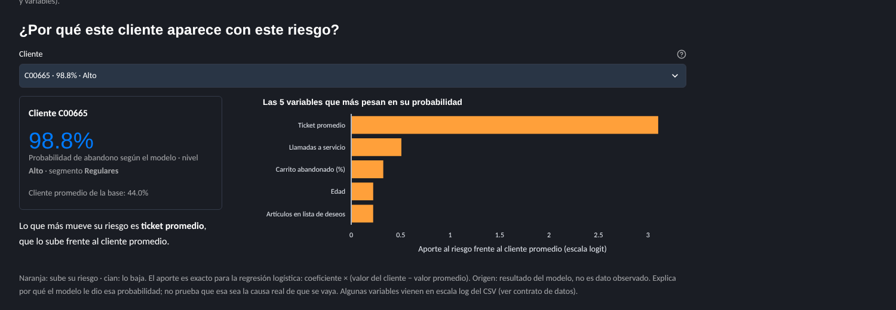
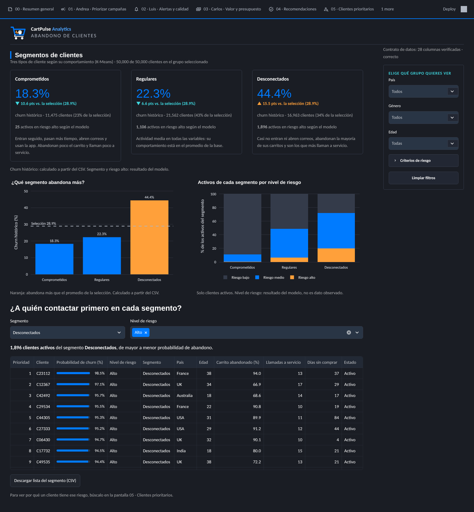

# Mi avance de la semana

Víctor Alejandro García Hernández - A01784206
Equipo 5, E-commerce customer churn

Mis compromisos de esta semana en la hoja de la concentración eran:

- **Juan:** gráfica que explique cada predicción («por qué está en riesgo»).
- **Christelle:** página Segmentos (usa el clustering de Enrique).

Los dos quedaron en el dashboard de Streamlit.

## 1. ¿Por qué este cliente aparece con este riesgo?

En la pantalla **05 · Clientes prioritarios**, debajo de la tabla de scoring, ahora se puede elegir un cliente y ver las 5 variables que más pesan en su probabilidad de abandono, frente al cliente promedio de la base.

Cómo funciona: el modelo es una regresión logística, así que su logit es la suma de coeficiente × valor estandarizado de cada variable. Por eso el aporte de cada variable es exacto, no una aproximación: coeficiente × (valor del cliente − valor promedio). Las columnas de un mismo país o género se suman en un solo renglón. La gráfica marca en naranja lo que sube el riesgo y en cian lo que lo baja, y aclara que explica el resultado del modelo, no la causa real del abandono.

Archivos:

- Cálculo: `explicar_cliente()` en `src/modelo.py`
- Pantalla: sección «¿Por qué este cliente…?» en `paginas/clientes.py`

## 2. Página Segmentos

Nueva pantalla **06 · Segmentos**. Usa los mismos segmentos K-Means de `src/modelo.py` (Comprometidos, Regulares y Desconectados), así que el segmento de cada cliente coincide con la pantalla 05. Responde tres preguntas:

- Qué segmento abandona más, comparado con la selección actual.
- Cómo se reparten los activos de cada segmento por nivel de riesgo.
- A quién contactar primero en cada segmento, con una tabla descargable (`column_order`, `hide_index=True` y el origen de cada columna en la ayuda del encabezado).

Respeta los filtros de país, género y edad, y separa las cifras calculadas del CSV (churn histórico) de las del modelo (segmento y nivel de riesgo).

Archivos: `paginas/segmentos.py`, `src/puntuacion.py` y una línea nueva en `app.py`.

## Pruebas

Agregué `tests/test_explicacion_segmentos.py` (5 pruebas). Comprueba que los aportes reproducen exactamente la probabilidad del modelo, que se ordenan por peso, que las categóricas se agrupan y que las pantallas 05 y 06 se dibujan sin errores. Corre en el pipeline de GitHub Actions junto con las del equipo.

Resultado local con `python -m unittest discover -s tests -v`: **28 pruebas, todas correctas** (23 del equipo + 5 nuevas).

## Commit

- Pull request: (pegar aquí la liga del pull request)
