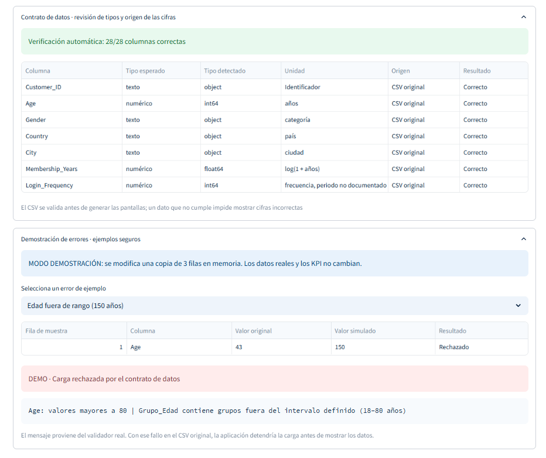
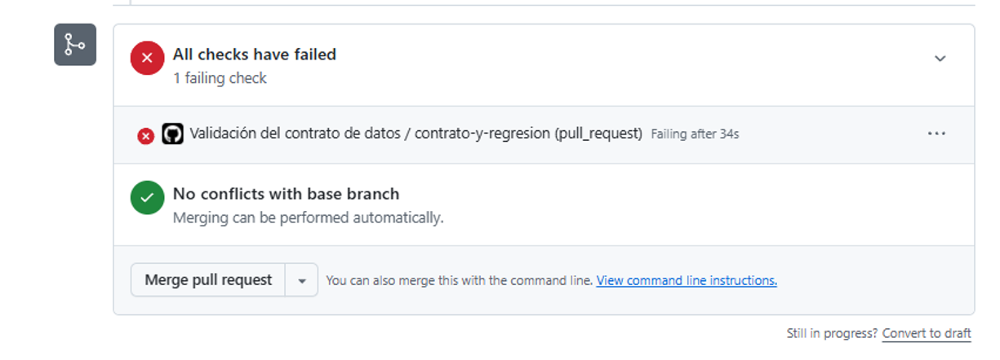
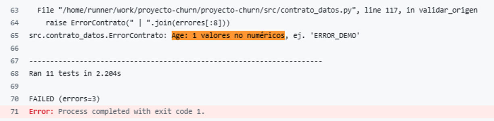

# Evidencias de avance individual — Erick

**Alumno:** Erick Eduardo Silva García  
**Matrícula:** A01665266  
**Proyecto:** Dashboard de abandono de clientes, Equipo 5

## Evidencias disponibles

### Validación de datos y demostración de errores (trabajo del equipo)

En la pantalla de **Luis > Monitoreo** se incorporó una revisión del contrato de datos antes de mostrar las cifras, junto con ejemplos controlados para comprobar cómo responde el sistema cuando se encuentran datos incorrectos. Estos ejemplos usan una copia de tres registros en memoria y no cambian el archivo original.

**Captura 1 — Revisión de columnas y error simulado en la aplicación**

**Captura 2 — GitHub Actions detectó el error intencional**

**Captura 3 — Detalle del error numérico en la columna Age**

Se colocó temporalmente `ERROR_DEMO` en un valor de `Age` de una rama separada; la comprobación automática falló y el CSV incorrecto **no se integró a `main`**. El sistema cuenta además con ejemplos de dato vacío, identificador duplicado y edad fuera de rango.

**Código y evidencia verificable:**

- [Pantalla de Luis](https://github.com/a01666361-beep/proyecto-churn/blob/main/paginas/luis.py)
- [Ejemplos de errores](https://github.com/a01666361-beep/proyecto-churn/blob/main/src/demo_validaciones.py)
- [Contrato de datos](https://github.com/a01666361-beep/proyecto-churn/blob/main/src/contrato_datos.py)
- [Ejecución fallida real](https://github.com/a01666361-beep/proyecto-churn/actions/runs/43277557193)

### Visualizaciones en Python (compromiso individual)

El compromiso registrado de Erick fue trabajar en **seis visualizaciones en Python**. En el dashboard publicado hay gráficos para analizar la tasa de abandono y compararla por comportamiento y segmentos: comparación contra meta, distribución de activos y abandono, mapa de calor de carrito y llamadas, y comparaciones por edad, país y valor del cliente. Se usan gráficos Plotly y datos preparados con pandas.

**Archivos publicados para revisar las visualizaciones:**

- [Pantalla Andrea](https://github.com/a01666361-beep/proyecto-churn/blob/main/paginas/andrea.py)
- [Gráficos de factores](https://github.com/a01666361-beep/proyecto-churn/blob/main/src/seccion_factores.py)
- [Gráficos de riesgo](https://github.com/a01666361-beep/proyecto-churn/blob/main/src/seccion_riesgo.py)
- [Pantalla Carlos](https://github.com/a01666361-beep/proyecto-churn/blob/main/paginas/carlos.py)

**Alcance de estas evidencias:** las tres capturas incluidas corresponden a la revisión de datos y a la demostración del error. No son capturas de las seis visualizaciones y por sí solas **no comprueban** la totalidad del compromiso individual. Para esa parte, se debe mostrar la aplicación publicada y comprobar qué visualizaciones corresponden al trabajo de Erick.
